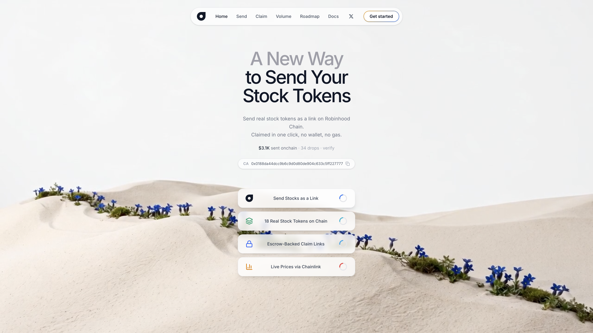
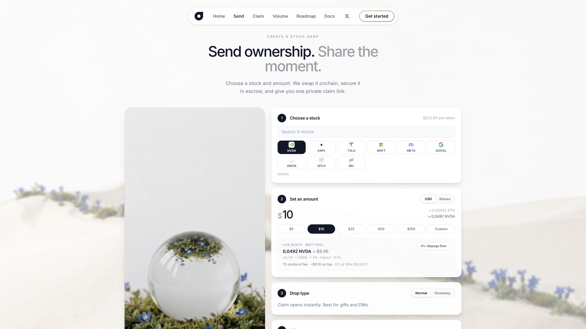
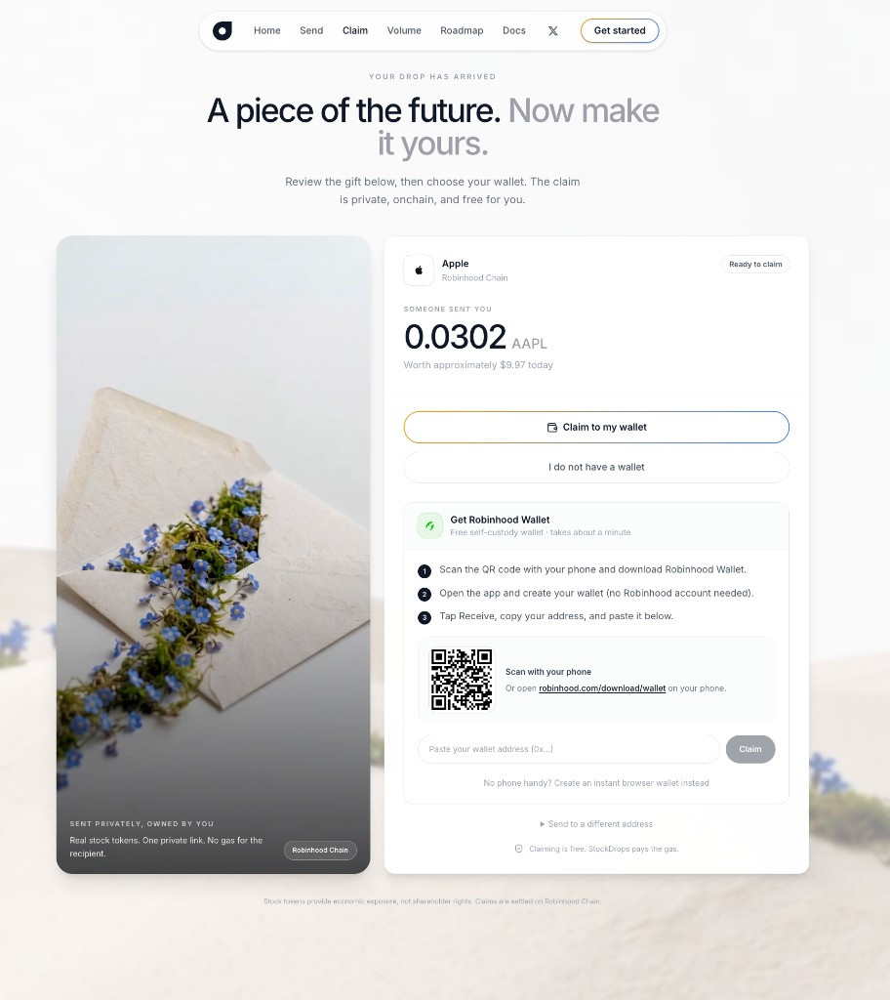

<div align="center">


# Givest

**Send real tokenized stocks as a link, on Solana.**

[](LICENSE)
[](https://solscan.io)
[](#how-it-works)

[**usegivest.app**](https://usegivest.app) · [@usegivest](https://x.com/usegivest)

<br />



</div>

<br />

Pick a stock and an amount. Phantom swaps SOL into the xStock on Jupiter and locks it in a one-time wallet. The private key is the claim link. The receiver claims in Phantom. A relayer pays the Solana fee. We never hold the stock.

## How it works

1. **Create**: Phantom swaps SOL to an xStock through Jupiter. The tokens land in a one-time Solana wallet. That wallet's secret is the claim link, and it never goes to our server.
2. **Claim**: the receiver connects Phantom. The page signs a transfer to their wallet with the key from the link. Our relayer co-signs as fee payer. It cannot change the recipient.
3. **Refund**: the sender can send the stock back from Your gifts, on the device that still has the link.

<br />

<div align="center">

| Send | Claim |
| :---: | :---: |
|  |  |
| Live Jupiter quotes before you send | Phantom onboarding built in |

</div>

<br />

Built on the same primitive:

- **Listed xStocks**: Nvidia, Apple, Tesla, Microsoft, Meta, Alphabet, Amazon, SpaceX, and Micron. Mints are the official Xs tokens.
- **Verified senders**: connect your X account and the receiver sees who the drop is from.
- **No-wallet onboarding**: receivers without a wallet are guided into Phantom.

## The contract

The website does not use a custom program. `contracts/StockDrops.sol` is the previous Robinhood Chain escrow and is not what usegivest.app sends with.

**Creating a drop.** Four entry points cover every route:

| Function | Route |
| --- | --- |
| `createDrop` | deposit stock tokens you already hold |
| `createDropWithEth` | ETH, swapped via a Uniswap V3 path |
| `createDropWithEthV4` | ETH, swapped in a single Uniswap V4 pool |
| `createDropWithEthViaUsdgV4` | ETH to USDG on V3, then USDG to the stock on V4 |

Every create takes a `claimKey` (the address of a one-time keypair whose private key lives only in the claim link), an expiry, a `claimableAt` timestamp (giveaway unlock) and a `splits` count (number of winners). The swap and the escrow registration happen atomically in one transaction, with a `minOut` slippage floor.

**Claiming.** `claim(claimKey, recipient, signature)` verifies that the claim key signed the recipient address (`claimDigest` is an EIP-191 digest of contract address, chain id, claim key and recipient). Anyone can submit the transaction, which is what makes claims gasless for the receiver: our relayer submits, the contract pays out. One claim per wallet, `splits` claims in total, each for an equal share.

**Refunding.** `refund` lets the sender pull back an unclaimed drop at any time. After expiry, `refundExpired` lets anyone push the remaining tokens back to the sender.

**Fees.** A basis-point fee is taken on create (`ProtocolFeePaid`), with discounts based on the sender's $GIVEST balance: 1% base, reduced at 10k, zero at 100k. Fee config is capped and only adjustable by the owner (`setFeeConfig`), and fees fund the relayer's gas and public giveaways.

**Events.** `DropCreated`, `DropClaimed`, `DropRefunded` and `ProtocolFeePaid` make every drop fully auditable. The volume page reads these events straight from Blockscout.

Tests in `contracts/test/StockDrops.t.sol` run against a fork of Robinhood Chain mainnet and cover claims, double-claim protection, bad signatures, expiry, giveaway locks, splits and refunds.

## Repository layout

```
contracts/   Foundry project - StockDrops.sol escrow + fork tests
web/         Next.js app - send flow, claim page, relayer + stats API
app/         iOS app (React Native / Expo) - embedded wallet, send + gasless claim
docs/        Screenshots and assets for this README
```

## Quickstart

### Contracts

```bash
cd contracts
forge install foundry-rs/forge-std
forge test --fork-url https://rpc.mainnet.chain.robinhood.com
```

### Web app

```bash
cd web
cp .env.example .env.local   # fill in contract address + relayer key
npm install
npm run dev
```

### iOS app

```bash
cd app
npm install
npx expo start   # press i for the simulator, or scan the QR with Expo Go
```

The app generates an embedded wallet on-device (Keychain via `expo-secure-store`), sends drops directly onchain and claims gaslessly through the relayer. See [`app/README.md`](app/README.md) for the full architecture.

### Local end-to-end demo

```bash
# 1. Fork mainnet
anvil --fork-url https://rpc.mainnet.chain.robinhood.com

# 2. Deploy against the fork
cd contracts
forge create src/StockDrops.sol:StockDrops --rpc-url http://127.0.0.1:8545 \
  --private-key <anvil-key> --broadcast \
  --constructor-args <WETH> <V3_ROUTER> <V4_POOL_MANAGER> <FEE_RECIPIENT>

# 3. Point web/.env.local at the fork + contract, then npm run dev
```

## Addresses (Robinhood Chain mainnet, chain id 4663)

| What | Address |
| --- | --- |
| WETH | `0x0Bd7D308f8E1639FAb988df18A8011f41EAcAD73` |
| USDG | `0x5fc5360D0400a0Fd4f2af552ADD042D716F1d168` |
| Uniswap V3 SwapRouter | `0xCaf681a66D020601342297493863E78C959E5cb2` |
| Stock tokens + Chainlink feeds | see `web/lib/config.ts` |

Escrow contracts and all protocol volume are public - every create and claim can be verified on [Blockscout](https://robinhoodchain.blockscout.com).

## Security model

- The claim link **is** the money: whoever has the link can claim the drop. Links are never stored server-side.
- The relayer key only pays the Solana fee and never holds the stock. The tokens sit in the one-time wallet until claimed or refunded.
- The create fee is 1% in SOL. It funds gasless claims.

Found a vulnerability? Please reach out privately on X [@usegivest](https://x.com/usegivest) before disclosing.

## Disclaimer

xStocks on Solana provide economic exposure to the underlying stock, not shareholder rights.

## License

[MIT](LICENSE)
